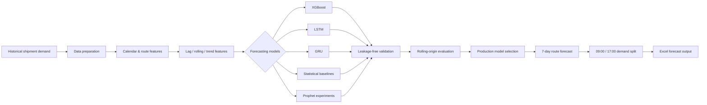

# TEKNOFEST 2026 — Linehaul Demand Forecasting (Hepsiburada)

Route-level **7-day shipment-demand forecasting** for Hepsiburada's linehaul network, built for the TEKNOFEST 2026 AI-Powered Linehaul Logistics Optimization Competition.


**In short**
- Forecasts shipment volume (`toplam_desi`) for every origin → destination route, 7 days ahead, for both demand completion times (09:00 and 17:00).
- Compares **XGBoost, LSTM, GRU** and Prophet against naive, seasonal-naive, moving-average and EMA baselines.
- Features are **leakage-free**: lags and rolling statistics use only data available before the forecast date, and XGBoost forecasts recursively on its own predictions.
- The production model was chosen with **rolling-origin validation** rather than a single holdout week: rolling mean WMAPE **34.48% → 32.96%** and rolling mean MAE **1102.48 → 1069.97** against the previous XGBoost.
- Final deliverable: a validated forecast of **3,862 route-hour rows** for 29 June – 5 July 2026.

<!-- Takım çalışmasıysa buraya bir satır ekle: "Team project. My part: ..." Bireysel çalışmaysa: "Solo project." -->

---

## Results

| Model | Final-week WMAPE | Rolling mean WMAPE | Rolling mean MAE |
|---|---:|---:|---:|
| Previous XGBoost | **28.02%** | 34.48% | 1102.48 |
| **New XGBoost (production)** | 29.46% | **32.96%** | **1069.97** |

The previous XGBoost scores slightly better on the single final test week. The new model is better on average across the rolling-origin windows and varies less from fold to fold, so it is the one used in production. The project deliberately optimizes for consistency over time instead of one favorable test period.

Final configuration: `max_depth = 6`, `learning_rate = 0.05`, early stopping (262 trees selected).

---

## Pipeline



---

## Features

**Calendar:** campaign / special-day flags (plus before- and after-campaign), operationally closed days, weekend, day of week / month / year, week of year, cyclic weekday and yearly encodings.

**Route:** origin and destination transfer centers, route identity, transfer-center distance (Haversine in the earlier pipeline), historical route means and medians, route × weekday behavior. Categorical route information is kept for XGBoost; the recurrent models use normalized numeric inputs.

**Demand history** (only values available before the forecast date):
- lags of 1, 2, 3, 7, 14, 21 and 28 days
- rolling mean and median over 3, 7, 14 and 28 days, rolling standard deviation
- exponential moving averages, recent-vs-historical route ratios, short- and medium-term trend features
- route × weekday statistics; target encodings computed chronologically so a date never sees its own target

---

## Models

| Model | Role |
|---|---|
| **XGBoost** | Main model; final daily production approach (recursive 7-day forecasting) |
| **LSTM** | Direct multi-horizon (+7) recurrent model |
| **GRU** | Alternative recurrent architecture |
| **Prophet** | Route-level statistical experiment in the earlier pipeline |
| Naive / Seasonal naive / Moving average (7, 14) / EMA | Baselines |
| XGBoost + LSTM ensemble | Validation-weighted ensemble experiment |

### Keeping the future out of training

- **XGBoost (recursive):** after day 1, each prediction is appended to the history, lag and rolling features are recomputed, and the next day is predicted. Future lags come from predictions, never from real future targets.
- **LSTM / GRU (direct +7):** the history window holds known demand; the target channel for the next seven days is hidden from the model.
- The test period is opened only after feature, model and hyperparameter decisions are final.

---

## Evaluation

A single holdout week is misleading in volatile logistics data, so the project uses a chronological validation / test split **and** several rolling-origin windows.

- Metrics: WMAPE, MAE, RMSE, bias, R² where appropriate.
- Errors are broken down by route, weekday, demand level, campaign periods, closed days and sudden demand increases.

### 09:00 vs 17:00 demand

| Completion time | Median demand |
|---|---:|
| 09:00 | 143 |
| 17:00 | 1126.5 |

Binary and numeric hour encodings, hour × calendar and hour × route interactions, separate per-hour models and hour-aware LSTM/GRU models were tested. The extra interactions did not consistently improve rolling performance, so a single **hour-aware XGBoost** produces the hour-level split.

### Output checks

Before export, the forecast is checked for duplicate rows, missing predictions, infinite values and negative demand. The verified file has 3,862 route-hour rows (date, origin, destination, completion time, predicted volume).

---

## Repository

```text
.
├── teknofest_lojistik.ipynb   # main notebook: EDA, features, XGBoost / LSTM / GRU, baselines,
│                              # rolling-origin evaluation, error analysis, final forecast
├── talep_tahmin.py            # earlier pipeline: Haversine distances, XGBoost, Prophet, LSTM, GRU
├── requirements.txt
└── README.md
```

## Running

```bash
git clone https://github.com/yasinserifhan/Teknofest_Lojistik.git
cd Teknofest_Lojistik
python -m venv .venv
# Windows: .venv\Scripts\activate    Linux/macOS: source .venv/bin/activate
pip install -r requirements.txt
jupyter notebook teknofest_lojistik.ipynb
```

Developed with Python 3.10 and TensorFlow 2.10 (optional CUDA GPU for the recurrent models).

**Data is not included.** The notebook expects the competition files `teknofest26_gelismis.xlsx` and `sehirler_arasi_lojistik.xlsx`; the earlier pipeline uses `Desi_talep.xlsx` and `Koordinatlar_v2.xlsx`. Adjust the paths if your filenames differ.

**Reproducibility note:** a few final notebook cells call helper scripts under `analysis/` that are not in this repository yet, so the final optimization and Excel-export steps cannot be rerun from this repo alone.

---

## Competition

**TEKNOFEST 2026 — AI-Powered Linehaul Logistics Optimization Competition**, organized with Hepsiburada. The competition combines demand forecasting with mathematical optimization for linehaul transport planning; this repository covers the **forecasting** side.

Official page: https://www.teknofest.org/tr/yarismalar/yapay-zeka-destekli-lojistik-anahat-optimizasyonu-yarismasi/
