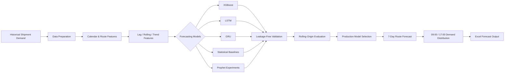

# TEKNOFEST 2026 — AI-Powered Linehaul Logistics Optimization

### Demand Forecasting Module · Hepsiburada × TEKNOFEST


This repository contains the **demand forecasting component** developed for the **TEKNOFEST 2026 AI-Powered Linehaul Logistics Optimization Competition**, organized in collaboration with **Hepsiburada**.

The competition combines **machine learning** and **mathematical optimization** for linehaul logistics. The work in this repository focuses on the first stage of that pipeline: estimating future shipment demand between transfer-center routes so that the resulting forecasts can be used by downstream transportation planning and fleet optimization systems.

> Official competition page:  
> https://www.teknofest.org/tr/yarismalar/yapay-zeka-destekli-lojistik-anahat-optimizasyonu-yarismasi/

---

## Project Goal

The main objective is to forecast **shipment volume (`toplam_desi`)** for each origin–destination route over a **7-day horizon**.

The forecasting problem is challenging because demand changes according to:

- origin and destination transfer centers,
- recent route-level demand,
- day of week and seasonal patterns,
- weekends,
- campaigns and special dates,
- operationally closed or low-activity days,
- sudden demand increases,
- and the demand completion time (`09:00` / `17:00`).

The project therefore evaluates multiple forecasting approaches and selects the production model using not only a single test split, but also **rolling-origin validation**.

---

## Solution Overview



---

## Data Engineering

### Calendar features

Known calendar information is added directly to the forecasting dataset:

- campaign / special-day indicator,
- before-campaign and after-campaign indicators,
- operationally closed days,
- weekend indicator,
- day of week,
- day of month,
- month,
- week of year,
- day of year,
- cyclic day-of-week encoding,
- cyclic yearly encoding.

These features help the model distinguish regular demand from special operational periods.

### Route features

Demand is modeled at the **origin → destination** level.

The pipeline uses:

- origin transfer center,
- destination transfer center,
- route identity,
- inter-city / transfer-center distance,
- historical route averages,
- route medians,
- route × day-of-week behavior.

Categorical route information is preserved for XGBoost, while recurrent models use normalized numerical representations.

### Historical demand features

For each route, only values available **before the forecast date** are used.

The main historical features include:

- lag values: `1, 2, 3, 7, 14, 21, 28` days,
- rolling mean: `3, 7, 14, 28` days,
- rolling median: `3, 7, 14, 28` days,
- rolling standard deviation,
- exponential moving averages,
- recent-route / historical-route ratios,
- short- and medium-term trend features,
- historical route × weekday statistics.

Target encodings are calculated chronologically so that the current date does not leak into its own features.

---

## Models Evaluated

| Model | Role in the project |
|---|---|
| **XGBoost** | Main tree-based forecasting model and final daily production approach |
| **LSTM** | Direct multi-horizon recurrent model for 7-day forecasting |
| **GRU** | Alternative recurrent architecture |
| **Prophet** | Route-level statistical forecasting experiment in the earlier pipeline |
| **Naive** | Simple last-value baseline |
| **Seasonal Naive** | Weekly seasonal baseline |
| **Moving Average** | 7-day and 14-day baseline |
| **EMA** | Exponential moving-average baseline |
| **XGBoost + LSTM Ensemble** | Validation-selected weighted ensemble experiment |

The earlier standalone Python pipeline also compares route-level XGBoost, Prophet, LSTM and GRU behavior. The notebook contains the more extensive leakage-free evaluation and model optimization workflow.

---

## Leakage-Free Forecasting

A major part of the project is preventing **future demand information from leaking into training or feature engineering**.

### XGBoost

XGBoost uses a **recursive 7-day forecasting strategy**.

After the first forecast day:

1. the model prediction is appended to the historical series,
2. the next day's lag and rolling features are recalculated,
3. the model predicts the following day.

Therefore, future lag features are based on **previous predictions**, not on the real future target.

### LSTM / GRU

The recurrent models use a **direct multi-horizon (+7)** setup.

The historical portion of the sequence contains known demand information, while the target channel for the future seven days is explicitly hidden from the model.

The test period is only opened after feature, model and hyperparameter decisions have been completed.

---

## Evaluation Strategy

A single holdout week can produce misleading conclusions in a volatile logistics dataset. For this reason, the project uses both:

- a chronological validation / test split,
- and multiple **rolling-origin** evaluation windows.

The main metrics are:

- **WMAPE**
- **MAE**
- **RMSE**
- **Bias**
- **R²** where appropriate

Model errors are also analyzed by:

- route,
- weekday,
- demand level,
- campaign periods,
- closed days,
- sudden demand increases.

---

## Production Model Selection

The final daily production model is an optimized **XGBoost** configuration.

During the final tuning stage, the selected setup uses:

```text
max_depth = 6
learning_rate = 0.05
early stopping
selected trees = 262
```

The production decision was based primarily on **rolling-origin performance and stability**, rather than choosing the model that happened to obtain the best score on a single final week.

### Evaluation snapshot

| Model | Final WMAPE | Rolling Mean WMAPE | Rolling Mean MAE |
|---|---:|---:|---:|
| Previous XGBoost | **28.02%** | 34.48% | 1102.48 |
| **New XGBoost Production** | 29.46% | **32.96%** | **1069.97** |

The previous XGBoost performs slightly better on the single final test window.  
However, the optimized model reduces rolling mean WMAPE from **34.48% to 32.96%** and rolling mean MAE from **1102.48 to 1069.97**, while also reducing fold-to-fold variability. For this reason, it is used as the daily production model.

This distinction is intentional: the project prioritizes performance that is more consistent across time instead of optimizing around one favorable test period.

---

## 09:00 / 17:00 Demand Analysis

The dataset contains two demand completion times:

- `09:00`
- `17:00`

Their demand distributions are substantially different.

| Completion time | Median demand |
|---|---:|
| 09:00 | 143 |
| 17:00 | 1126.5 |

The difference also changes by route, origin, destination and weekday.

Several strategies were tested:

- binary hour encoding,
- numeric hour encoding,
- hour × calendar interactions,
- hour × route / location interactions,
- separate models for 09:00 and 17:00,
- hour-aware LSTM and GRU models.

The additional interaction features did not consistently improve rolling performance. A **shared hour-aware XGBoost model** is therefore used for the hour-level distribution stage, avoiding unnecessary model complexity.

---

## Final Forecast Output

The final forecasting workflow produces a route-level forecast for:

**29 June – 5 July 2026**

The generated output contains:

- 7 forecast days,
- origin transfer center,
- destination transfer center,
- demand completion time,
- predicted shipment volume.

The final validation step checks that the output contains:

- no duplicate rows,
- no missing predictions,
- no infinite values,
- no negative demand predictions.

The verified forecast contains **3,862 route-hour rows**.

Example output file:

```text
outputs/
└── TALEP TAHMİN_29 Haziran-5 Temmuz 2026.xlsx
```

---

## Repository Files

```text
.
├── lojistik_ikinci.ipynb
├── talep_tahmini (2).py
└── README.md
```

### `lojistik_ikinci.ipynb`

Main experimental notebook.

It includes:

- exploratory analysis,
- data engineering,
- leakage-free XGBoost forecasting,
- LSTM optimization,
- GRU comparison,
- baseline models,
- ensemble experiments,
- rolling-origin evaluation,
- route and event-based error analysis,
- 09:00 / 17:00 demand analysis,
- final model selection,
- forecast generation and validation.

### `talep_tahmini (2).py`

Earlier / alternative forecasting pipeline.

It includes:

- calendar features,
- route coordinate joins,
- Haversine distance calculation,
- lag and rolling features,
- XGBoost,
- Prophet,
- LSTM,
- GRU,
- route-level error comparison,
- 7-day forecast generation.

---

## Running the Project

### 1. Clone the repository

```bash
git clone <repository-url>
cd <repository-folder>
```

### 2. Create an environment

```bash
python -m venv .venv
```

Windows:

```bash
.venv\Scripts\activate
```

Linux / macOS:

```bash
source .venv/bin/activate
```

### 3. Install dependencies

```bash
pip install pandas numpy matplotlib seaborn scikit-learn xgboost tensorflow prophet openpyxl jupyter
```

The main notebook was developed in a Python 3.10 / TensorFlow 2.10 environment with optional CUDA GPU support for recurrent-model training.

### 4. Add the input data

The notebook expects the competition data and route-distance data to be available locally.

Example filenames used in the project include:

```text
teknofest26_gelismis.xlsx
sehirler_arasi_lojistik.xlsx
```

The earlier Python pipeline uses:

```text
Desi_talep.xlsx
Koordinatlar_v2.xlsx
```

Adjust the file paths if your local filenames are different.

### 5. Run the notebook

```bash
jupyter notebook lojistik_ikinci.ipynb
```

---

## Reproducibility Note

The final notebook cells also reference additional local experiment scripts and output-building utilities under directories such as:

```text
analysis/
artifact_work/
outputs/
```

Those auxiliary files are not represented by the two core files shown in this repository structure above.

If the full experiment folder is added to the repository, the final optimization and Excel-generation workflow can be exposed as part of the reproducible project structure as well.

Some final notebook cells also contain machine-specific executable paths. These should be replaced with environment-independent commands before running the project on another computer.

---

## Key Takeaways

- Logistics demand is modeled **per origin–destination route**.
- Forecasting uses both **calendar information and historical route behavior**.
- XGBoost forecasts future days **recursively** without using future targets.
- LSTM and GRU are evaluated using a leakage-free **7-day direct forecasting** setup.
- Baseline models are retained so that complex approaches are compared against simple alternatives.
- Model selection is based on **rolling performance and stability**, not only one final test window.
- Demand at `09:00` and `17:00` is analyzed separately before producing the hour-level output.
- The final forecast is validated before export to Excel.

---

## Competition

**TEKNOFEST 2026 — AI-Powered Linehaul Logistics Optimization Competition**  
Organized in collaboration with **Hepsiburada**.

The broader competition objective is to combine shipment-demand forecasting with optimization techniques that can support efficient linehaul transportation planning. This repository documents the **demand forecasting side** of that problem.
